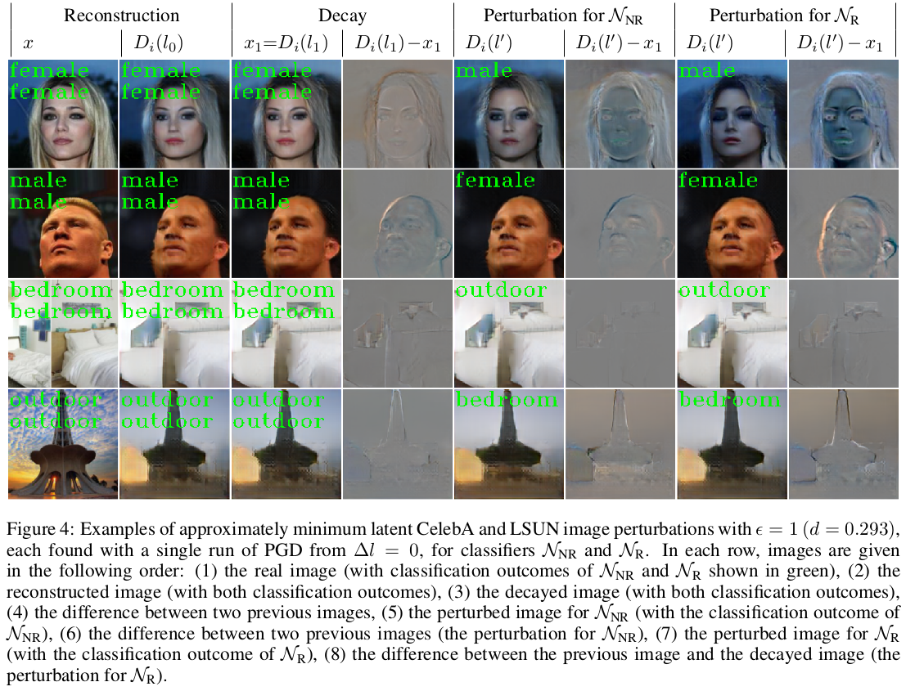

# Robustness Evaluation of Neural Networks with Generative Models

[](https://github.com/igor-buzhinsky/latent-space-nn-evaluation/actions/workflows/ci.yml)

[](LICENSE)

Measure how robust image classifiers are by searching for adversarial perturbations in the *latent spaces* of generative models (GANs and autoencoders), rather than in pixel space.

## Overview

This toolset implements a framework to measure the performance of feed-forward artificial neural network classifiers with generative models. The implementation concerns image classification. The framework is described in the following arXiv preprint:

* [Igor Buzhinsky, Arseny Nerinovsky, Stavros Tripakis. Metrics and methods for robustness evaluation of neural networks with generative models. arXiv preprint arXiv:2003.01993 (2020)](https://arxiv.org/abs/2003.01993)

Datasets with built-in support: [MNIST](http://yann.lecun.com/exdb/mnist/), [CelebA](http://mmlab.ie.cuhk.edu.hk/projects/CelebA.html) (gender classification), [LSUN](https://github.com/fyu/lsun) (scene type classification: bedrooms vs. church outdoors), [ImageNet-1k](https://image-net.org/challenges/LSVRC/2012/).

For CelebA and LSUN, here are some examples of approximately minimum adversarial perturbations in latent spaces for a non-robust (NR) and a robust (R) classifier:



## Installation

The toolset requires Python 3.11 or newer and uses [Poetry](https://python-poetry.org/) for dependency management. Dependencies are declared in [pyproject.toml](pyproject.toml) and pinned in [poetry.lock](poetry.lock).

```bash
poetry install                    # core dependencies (PyTorch, torchvision, etc.)
poetry install --with notebooks   # also install Jupyter/IPython to run the notebooks
poetry install --extras imagenet  # also install the robustness package for the ImageNet experiments
```

Then run scripts inside the environment, e.g. `poetry run python Adversarial.py --help`, or start the notebooks with `poetry run jupyter notebook`. A GPU is used automatically if available.

## Quick start

All models needed for MNIST are included in the repository, and the dataset is downloaded automatically. The following command searches for minimum adversarial perturbations in the latent spaces of class-specific MNIST WGANs for a non-robust (`plain`) and a robust classifier, using 20 images:

```bash
poetry run python Adversarial.py --dataset MNIST --command generate_minimum --num_images 20 \
    --classifier_filenames classifiers_architecture0/plain_MNIST.bin classifiers_architecture0/robust_MNIST.bin
```

It runs reconstruction-based search (latent codes of real images) and generation-based search (random latent codes), and prints statistics such as these (excerpt):

```
Accuracy of classifier 0 on 20 reconstructed images: 100.00%
Accuracy of classifier 0 on 20     perturbed images: 0.00%
For classifier 0 and 20 images,             ||dl|| (scaled L2): mean=0.38638, std=0.19707, Q0=0.04050, ...
For classifier 0 and 20 images,             ||dx|| (scaled L2): mean=0.51518, std=0.15736, Q0=0.06550, ...
```

Here, `||dl||` is the norm of the found latent perturbation and `||dx||` is the norm of the resulting change in the image. Logs and figures (images and histograms) are saved to a new `logdir_<timestamp>` directory.

## Repository structure

* Command-line scripts:
  * [Adversarial.py](Adversarial.py): latent space performance metrics, including the search for latent adversarial perturbations (MNIST, CelebA, LSUN).
  * [AdversarialImageNet.py](AdversarialImageNet.py): the same for ImageNet with BigGAN.
  * [ClassifierTraining.py](ClassifierTraining.py): classifier training and evaluation of robustness in the original image space.
  * `*Experiments.py`: launchers that run the scripts above for multiple settings; they can be used to reproduce the experiments from the paper.
* Notebooks: [Adversarial.ipynb](Adversarial.ipynb), [AdversarialImageNet.ipynb](AdversarialImageNet.ipynb), [ClassifierTraining.ipynb](ClassifierTraining.ipynb), [MNIST.ipynb](MNIST.ipynb) (see below).
* [latentspace](latentspace): the library used by the scripts and notebooks.
  * [adversaries.py](latentspace/adversaries.py): projected gradient descent (PGD) search for adversarial perturbations.
  * [adversarial_generation.py](latentspace/adversarial_generation.py): latent adversarial search over generative models and the resulting statistics.
  * [generative.py](latentspace/generative.py): wrappers of generative models (WGAN, BigGAN, PIONEER) with a common encode/decode interface.
  * [gan.py](latentspace/gan.py): the MNIST WGAN with spectral normalization.
  * [cnn.py](latentspace/cnn.py): classifier architectures, training and evaluation.
  * [datasets.py](latentspace/datasets.py): dataset wrappers with loaders and augmentation.
  * [evaluation_util.py](latentspace/evaluation_util.py): conventional accuracy/robustness evaluation and visualization of generative models.
  * Helpers: [layers.py](latentspace/layers.py), [loader_decorators.py](latentspace/loader_decorators.py), [torch_util.py](latentspace/torch_util.py), [plotting.py](latentspace/plotting.py), [logging_util.py](latentspace/logging_util.py), [runtime.py](latentspace/runtime.py), [paths.py](latentspace/paths.py), [compat.py](latentspace/compat.py).
* [tests](tests): unit tests of `latentspace`.
* Bundled models: `classifiers_architecture{0,1,2}/` (MNIST, CelebA and LSUN classifiers, three architectures each) and `mnist-gan/` (class-specific MNIST WGANs).
* Third-party code (copied, slightly modified): [biggan](biggan) ([BigGAN-PyTorch](https://github.com/ajbrock/BigGAN-PyTorch)) and [pioneer](pioneer) ([PIONEER](https://github.com/AaltoVision/pioneer)).

## Running: MNIST

The starting point is to run the toolset on MNIST, as all trained models are small and already included in this repository.

You can work with the following command-line scripts and Jupyter notebooks:

* [Adversarial.py](Adversarial.py): calculation of latent space performance metrics, including the search for latent adversarial perturbations.
* [Adversarial.ipynb](Adversarial.ipynb): this notebook shows some features supported by Adversarial.py in a more user-friendly form. The target dataset is specified in one of the top cells.
* [ClassifierTraining.py](ClassifierTraining.py): auxiliary script that implements classifier training and evaluation of classifier robustness in the original space.
* [ClassifierTraining.ipynb](ClassifierTraining.ipynb): this notebook shows some features supported by ClassifierTraining.py in a more user-friendly form. The target dataset is specified in one of the top cells (CelebA and LSUN only). In addition, this notebook shows image generation with robust classifiers, which is most visible on MNIST and CelebA.
* [MNIST.ipynb](MNIST.ipynb): this notebook is an adaptation of [ClassifierTraining.ipynb](ClassifierTraining.ipynb) for MNIST. In addition, it contains code to train class-specific MNIST WGANs.

Some examples of running the aforementioned .py scripts are given in the files [ClassifierTrainingExperiments.py](ClassifierTrainingExperiments.py), [ClassifierEvaluationExperiments.py](ClassifierEvaluationExperiments.py), [AdversarialExperiments.py](AdversarialExperiments.py), [LatentAccuracyExperiments.py](LatentAccuracyExperiments.py). These scripts can also be used to reproduce the experiments from our paper.

## Running: CelebA and LSUN

CelebA and LSUN classifier models are included in the repository, but classifier training/evaluation for these datasets will require downloading the datasets themselves. This will be done automatically for CelebA during the first run, but you will need to download LSUN on your own. You need to have the following directories:

* data/LSUN/bedroom_train_lmdb ([download archive](http://dl.yf.io/lsun/scenes/bedroom_train_lmdb.zip), size warning!)
* data/LSUN/bedroom_val_lmdb ([download archive](http://dl.yf.io/lsun/scenes/bedroom_val_lmdb.zip))
* data/LSUN/church_outdoor_train_lmdb ([download archive](http://dl.yf.io/lsun/scenes/church_outdoor_train_lmdb.zip))
* data/LSUN/church_outdoor_val_lmdb ([download archive](http://dl.yf.io/lsun/scenes/church_outdoor_val_lmdb.zip))

Evaluation of latent performance metrics for CelebA and LSUN will also require pretrained [PIONEER](https://github.com/AaltoVision/pioneer) models. You will need to download the following files (~670 MB each) and place them at the following locations:

* [pioneer/CelebA-128-female/checkpoint/20580000_state](https://drive.google.com/open?id=1X1nkyK3hkaahBYRfH36X5yyInZGYrQbW)
* [pioneer/CelebA-128-male/checkpoint/22452000_state](https://drive.google.com/open?id=1hWpm1vLXd_ay2M4AxOMxLjw4mD9gyZzH)
* [pioneer/LSUN-128-bedroom/checkpoint/15268000_state](https://drive.google.com/open?id=1sz-_3SsENJ9a4OVUF2o6q7riCcgeVlWS)
* [pioneer/LSUN-128-church_outdoor/checkpoint/20212000_state](https://drive.google.com/open?id=1eqGKeHQf-KvAe7zrvFiYjqqrEwsxvcwb)

## Running: ImageNet

To work with ImageNet-1k (1000 classes):

* Download the archive ILSVRC2012_img_val.tar with the validation data from the [ImageNet download page](https://image-net.org/challenges/LSVRC/2012/2012-downloads.php) (you will need to register and accept some terms). Unpack this archive to data/ImageNet/ILSVRC2012_img_val (so that all the images are in this folder, without subfolders). The corresponding reference labels are already included in this repository.
* Download this [pretrained BigGAN model](https://drive.google.com/open?id=1dmZrcVJUAWkPBGza_XgswSuT-UODXZcO). Unpack the archive to biggan/weights/BigGAN_I128_hdf5_seed0_Gch96_Dch96_bs1_nDa8_nGa8_Glr1.0e-04_Dlr4.0e-04_Gnlinplace_relu_Dnlinplace_relu_Ginitortho_Dinitortho_Gattn64_Dattn64_Gshared_hier_ema (so that .pth files are inside this folder, without subfolders). For convenience, the relevant [code of BigGAN](https://github.com/ajbrock/BigGAN-PyTorch) is already copied to this repository. If you need BigGAN on its own, use the code from the original repository.
* Download the [robust ImageNet classifier](http://andrewilyas.com/ImageNet.pt) and make it available as imagenet-models/ImageNet.pt. Other (non-robust) classifiers will be downloaded automatically upon first access.
* Check the notebook [AdversarialImageNet.ipynb](AdversarialImageNet.ipynb) or the scripts [AdversarialImageNet.py](AdversarialImageNet.py), [AdversarialImageNetExperiments.py](AdversarialImageNetExperiments.py).

## Working with other image datasets

To work with a custom dataset, you need to implement a new dataset wrapper in [latentspace/datasets.py](latentspace/datasets.py). Add support for this dataset in [latentspace/cnn.py](latentspace/cnn.py) (implement a new architecture if needed). Train classifiers for this dataset with ClassifierTraining.py. Then, you will need to train generative models for each image class. Three existing options are provided by [latentspace/generative.py](latentspace/generative.py):

* class WGAN: WGANs + image reconstruction with gradient descent (Adam). This is the simplest and the most lightweight option, but for more complex datasets, this way of reconstruction will take longer and may be less precise. An example of training MNIST WGANs is given in [MNIST.ipynb](MNIST.ipynb).
* class BigGAN: [BigGAN](https://github.com/ajbrock/BigGAN-PyTorch) + image reconstruction with gradient descent (Adam). BigGAN can be replaced with another class-conditional GAN.
* class PIONEER: [PIONEER](https://github.com/AaltoVision/pioneer) autoencoder. A copy of PIONEER (slightly modified) is included in this repository ([pioneer/src](pioneer/src)), but if you need PIONEER on its own, take it from the original repository. Model training and loading are memory-intensive.

Alternatively, you can implement a different subclass of GenerativeModel. Even if you implement only generation (generate/decode) but not approximation in the latent space (encode), evaluation of latent space metrics based on generation should work.

## Development

Code (including notebooks) is formatted with [black](https://github.com/psf/black), linted with [ruff](https://docs.astral.sh/ruff/) and type-checked with [pyrefly](https://pyrefly.org/). These tools are in the `dev` group; vendored `biggan/` and `pioneer/` are excluded. To run all of them:

```bash
./lint.sh        # check only
./lint.sh --fix  # apply formatting and safe fixes, then check
```

Unit tests of the `latentspace` package are in [tests](tests). They use small in-memory data and the bundled MNIST models (no dataset downloads) and take a few seconds. To run them:

```bash
./unit_test.sh     # or: ./unit_test.sh -v, ./unit_test.sh -k PGD
```

Both run on every push in [GitHub Actions](.github/workflows/ci.yml). [smoke_test.sh](smoke_test.sh) runs the command-line scripts on real datasets (edit the dataset lists and classifier paths in it first).

## Citation

If you use this code, please cite:

```bibtex
@article{buzhinsky2020metrics,
  title   = {Metrics and methods for robustness evaluation of neural networks with generative models},
  author  = {Buzhinsky, Igor and Nerinovsky, Arseny and Tripakis, Stavros},
  journal = {arXiv preprint arXiv:2003.01993},
  year    = {2020}
}
```
